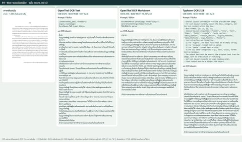
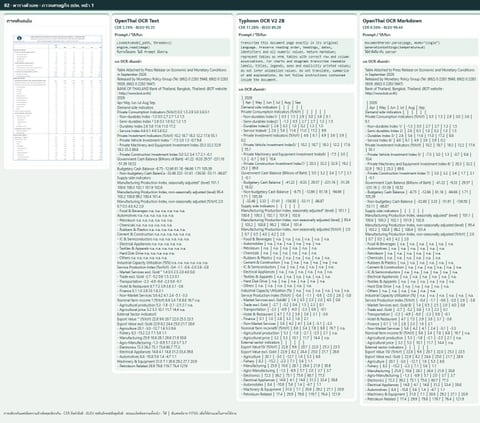
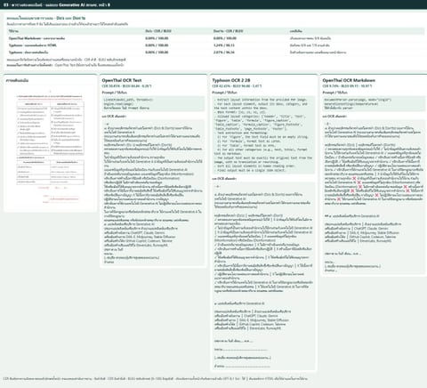
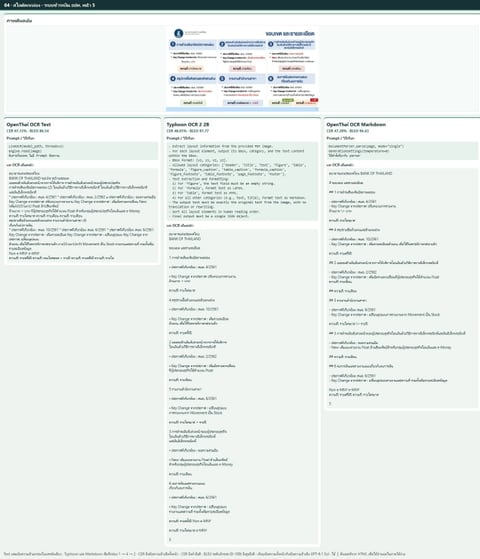
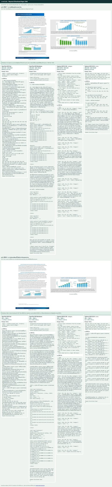
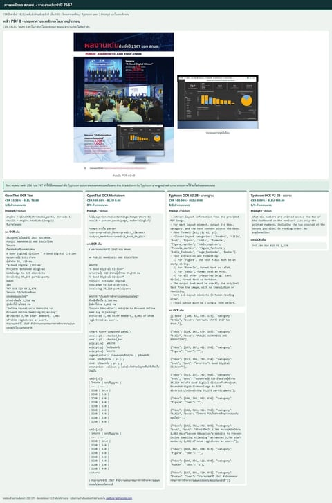
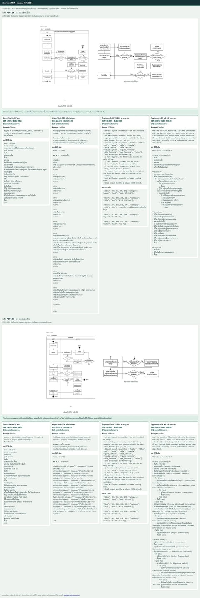
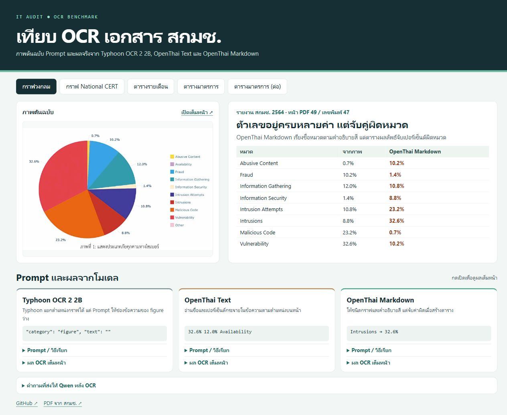
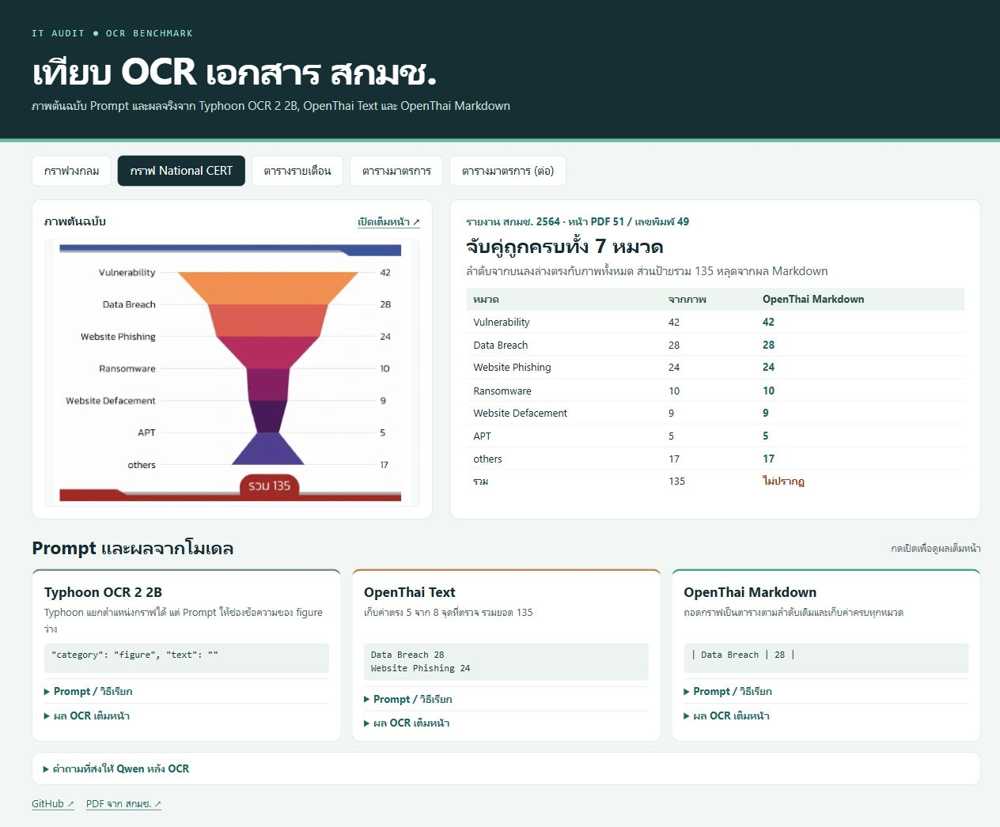

# Thai OCR benchmark for IT audit

[ภาษาไทย](README.th.md) · [See the seven tests in order](#seven-tests-in-the-order-i-ran-them) · [Open the interactive comparison](https://lengtsp.github.io/openthai2.0_ocr_markdown_and_text_test/)

A single PDF can contain paragraphs, tables, slides, and flowcharts. I gave **OpenThai OCR Text**, **OpenThai OCR Markdown**, and **Typhoon OCR V2 2B** the same page images and checked both how accurately they read the text and whether they kept related information together.

## 1. Start with single-column text

On 10 pages of continuous prose, OpenThai Text had a **0.39% character error rate (CER)**, close to Typhoon at **0.40%** and ahead of OpenThai Markdown at **0.70%**. Median request times were **0.31**, **4.53**, and **11.58 seconds** respectively on the test machine. I would start with Text when making policies or manuals searchable. [Results for the 10-page sample](data/prose-results.json)

## 2. Check whether tables and slides keep information in the right place

OpenThai Markdown kept all **nine items per column** in an NCSA Do’s and Don’ts example. Typhoon returned the left and right items as HTML row pairs, which is useful when you want to keep each pair together. On slides with multiple text boxes, check the reading order before using the output.

| Page type | Pages | OpenThai Text | Typhoon OCR V2 2B | OpenThai Markdown |
|---|---:|---:|---:|---:|
| Continuous prose | 30 | 2.35% | **1.69%** | 1.70% |
| Simple tables | 5 | 9.25% | **1.71%** | 2.50% |
| Complex tables | 13 | 23.28% | 20.25% | **10.66%** |
| Bank of Thailand slides exported to PDF | 33 | 52.56% | **18.55%** | 21.88% |

Each row compares CER across the same pages. Lower is better. The slide group comes from one Bank of Thailand deck and overlaps with some text and table pages. [Results by page type (Thai)](qwen-ocr-routing.md) · [Per-page scores](data/per-page.csv)

- **Tables.** On the NCSA monthly table, OpenThai Text put **75/130** values in the correct row and month. Typhoon and Markdown each got **130/130**. On a simulated bank reconciliation, the three models scored **89/90**, **90/90**, and **89/90**, respectively. [NCSA monthly table](https://lengtsp.github.io/openthai2.0_ocr_markdown_and_text_test/#monthly) · [Internal audit results (Thai)](internal-audit-ocr-review.md)
- **Slides.** On page 23, with a single bullet group, CER was **10.94%**, **7.29%**, and **0.96%** for Text, Typhoon, and Markdown respectively. On page 27, which embeds a form image, the scores were **84.64%**, **1.44%**, and **8.00%**. [Bank of Thailand PDF, page 27](https://www.bot.or.th/content/dam/bot/documents/th/our-roles/payment-systems/payment/payment-all-hearing/payment-supervisory-data.pdf#page=27) · [Per-page scores](data/per-page.csv)

## 3. Try charts, screenshots, and flowcharts

Typhoon appears twice below because I tested the same model with its standard prompt and with a prompt tailored to the task.

| Example | OpenThai Text | OpenThai Markdown | Typhoon, standard prompt | Typhoon, focused prompt |
|---|---|---|---|---|
| Bank of Thailand chart, p. 7 | Read many values without linking them to years | **26/26** year–value pairs | 0/26 pairs | **26/26** pairs |
| NCSA dashboard screenshot, p. 8 | **6/6** numbers, first two swapped | 0/6 numbers | 0/6 numbers | **6/6** numbers in order |
| ETDA flowcharts, pp. 24 and 26 | Read nearly all selected labels, 0/12 arrows | Converted the flowchart into a table, 0/12 arrows | Classified it as a figure, 0/12 arrows | **6/12** arrows |

- **Bank of Thailand charts.** Markdown and Typhoon with a focused prompt tied on the labeled charts. On the unlabeled stacked chart on page 8, they gave different figures for 2024 internet banking: 400,000 and 450,000. Check the source data before citing a value that the chart does not print. [Full comparison image (Thai)](docs/assets/regulator-chart.jpg) · [Bank of Thailand PDF](https://www.bot.or.th/content/dam/bot/documents/th/our-roles/payment-systems/payment-systems-policy/payment-directional-paper-2568-th.pdf#page=7)
- **NCSA dashboard.** Text found all six numbers but returned `284` before `747`. Typhoon, when asked for those six numbers, returned them in the right order. This check covered the numbers. Their metric labels need a separate check. [Full comparison image (Thai)](docs/assets/regulator-dashboard.jpg) · [NCSA PDF](https://www.ncsa.or.th/media/uploads/2025/03/14/ncsa-annual-2024_e-book_uid_67d3ad045e4fa.pdf#page=8)
- **ETDA flowcharts.** Text recovered most of the selected step labels. A focused Typhoon prompt followed more arrows than the other runs, but still sent a complete-information case to rejection where the original directs the customer to sign electronically. [Full comparison image (Thai)](docs/assets/regulator-flow.jpg) · [Source PDFs](data/regulator-visual/sources.json)

Character error rate and BLEU for the selected fields

| What was scored | OpenThai Text | OpenThai Markdown | Typhoon, standard prompt | Typhoon, focused prompt |
|---|---:|---:|---:|---:|
| Bank of Thailand chart, p. 7 · 26 printed values | 6.38% / 86.81 | 0.00% / 100.00 | 100.00% / 0.00 | 0.00% / 100.00 |
| NCSA dashboard, p. 8 · six numbers in reading order | 33.33% / 76.68 | 100.00% / 0.00 | 100.00% / 0.00 | 0.00% / 100.00 |
| ETDA cheque deposit, p. 24 · eight step labels | 0.70% / 99.23 | 22.38% / 74.95 | 100.00% / 0.00 | 0.00% / 100.00 |
| ETDA cash withdrawal, p. 26 · eight step labels | 0.63% / 98.78 | 75.95% / 4.25 | 100.00% / 0.00 | 0.00% / 100.00 |

Each cell shows **CER / character-level BLEU** for the selected fields. Lower CER and higher BLEU are better. Missing fields count as empty text. The table above tracks year–value pairs and arrows separately. The stacked chart on page 8 had no printed per-series values to score. [Arrow checks](data/regulator-visual/flow-review.json)

## Seven tests in the order I ran them

### 1. NCSA preface · single-column text

On the NCSA manual’s preface (“คำนำ”), Typhoon matched the reference exactly (CER 0.00%, BLEU 100.00). OpenThai Markdown made minor errors, such as “Artificial” becoming “Artifificial” (CER 0.13%, BLEU 99.87). OpenThai Text read “AI” as “Al” and misread “คำนำ” (CER 0.52%, BLEU 99.08). Text took 0.37 seconds, compared with 3.03 seconds for Typhoon and 10.28 seconds for Markdown. For making manuals or policies searchable, this is the kind of page OpenThai Text handles well.

Preview the comparison and open the full image

### 2. Bank of Thailand economic table · values in the right rows

OpenThai Markdown had the best full-page text score and placed the numbers correctly in the two rows checked. OpenThai Text read the rows in order but dropped or misread some decimal points. Typhoon produced an HTML table with a custom prompt, but shifted a set of values onto the wrong line items.

Preview the comparison and open the full image

### 3. NCSA Do’s and Don’ts · two independent lists

OpenThai Markdown returned all nine Do’s and nine Don’ts in order, with each list intact. Typhoon kept items on the correct side in HTML row pairs. To read one list at a time, extract the entire left column first and then the right. OpenThai Text mixed the columns, putting “ความถูกต้อง” from the Don’ts at the end of a line on the Do’s side. Markdown separated the lists most clearly in its direct output.

Preview the comparison and open the full image

### 4. Bank of Thailand slide · reading six numbered boxes

The slide is numbered 1 → 2 → 3 → 4 → 5 → 6. Typhoon and OpenThai Markdown read down the columns in the order 1 → 4 → 2 → 5 → 3 → 6. Typhoon preserved much of the wording (CER 48.01%, BLEU 97.77). Markdown repeated “ความถี่: รายเดือน” (CER 47.28%, BLEU 94.43). Text merged content across boxes and misread more characters (CER 67.13%, BLEU 86.54). BLEU stayed high because many passages still matched despite the changed reading order.

Preview the comparison and open the full image

### 5. Bank of Thailand charts · match years to printed values

OpenThai Markdown and Typhoon with a chart-specific prompt tied at 26/26 year–value pairs. OpenThai Text read many values without clearly linking them to years. Standard Typhoon located the chart but left the chart text empty. On the stacked chart without printed values, Markdown and targeted Typhoon returned different numbers. Cite the source data for those figures.

Preview the comparison and open the full image

### 6. NCSA dashboard · targeted Typhoon kept the right order

When asked for the dashboard numbers, Typhoon returned all six values in the same order as the image. OpenThai Text also read all six but swapped the first two. OpenThai Markdown and standard Typhoon read surrounding text but missed all six dashboard numbers. Targeted Typhoon performed best when the order mattered.

Preview the comparison and open the full image

### 7. ETDA flowcharts · read the steps and check the arrows

OpenThai Text read nearly all checked box labels. OpenThai Markdown converted the diagram into a table and dropped several boxes on the withdrawal page. Standard Typhoon detected the diagram as a figure and left its text empty. Targeted Typhoon read all checked labels and followed 6 of 12 arrows correctly. It still sent the complete-information branch to “ปฏิเสธรายการ” (reject the transaction) instead of “ลงลายมือชื่อ” (sign). Before using a flowchart as audit evidence, I would check every arrow and condition against the original.

Preview the comparison and open the full image

## 4. Pick a model for the audit task

I would use **OpenThai Text** to make prose searchable, **OpenThai Markdown** for multi-column lists or charts with printed values, and **Typhoon with a focused prompt** when I need numbers from a screenshot, row pairs, or an initial reading of a flowchart. Before citing the output in an audit report, I would verify each value against its heading, year, and unit, and check that each decision arrow leads to the right step. [Internal audit results (Thai)](internal-audit-ocr-review.md)

## Interactive NCSA examples

Compare the source image, prompt, and full OCR output for a pie chart, a National CERT chart, a monthly table, and two pages of a control matrix. [Open the interactive comparison](https://lengtsp.github.io/openthai2.0_ocr_markdown_and_text_test/) · [Website source](docs/)

- **ThaiCERT pie chart.** OpenThai Markdown read the category names but assigned 32.6% to Intrusions. The image assigns it to Vulnerability. [Open the pie chart comparison](https://lengtsp.github.io/openthai2.0_ocr_markdown_and_text_test/#pie)
- **National CERT chart.** OpenThai Markdown matched all seven categories and their values in order, but missed the printed total of 135. Typhoon’s standard prompt calls for an empty text field on figure blocks. [Open the National CERT comparison](https://lengtsp.github.io/openthai2.0_ocr_markdown_and_text_test/#funnel)

## Results across 293 pages

Across six public PDFs, **Typhoon OCR V2 2B had the lowest overall CER (5.07%)**. OpenThai Text had the shortest median request time on the test machine.

| Metric | Typhoon OCR V2 2B | OpenThai Text | OpenThai Markdown |
|---|---:|---:|---:|
| Overall CER ↓ | 5.07% | 7.98% | 5.96% |
| Numeric token F1 ↑ | 98.02% | 96.35% | 96.55% |
| Pages with HTML tables | 139 | 0 | 142 |
| Pages with incomplete output | 1 | 0 | 0 |
| Blank pages with spurious text | 0 | 0 | 7 |
| Median request time (seconds) | 4.55 | 0.27 | 8.74 |

CER counts character substitutions, deletions, and insertions after Unicode normalization and removal of whitespace. Numeric token F1 checks numbers within a page, so a correct amount in the wrong cell can still contribute to a high score.

| Document | Pages scored for CER | Typhoon OCR V2 2B | OpenThai Text | OpenThai Markdown |
|---|---:|---:|---:|---:|
| Bank of Thailand financial statements, 2025 | 82 | 0.72% | 2.20% | 1.36% |
| Bank of Thailand payment systems slides | 33 | 18.55% | 52.56% | 21.88% |
| Thailand’s Budget in Brief, FY 2026 | 137 | 5.00% | 2.76% | 5.39% |
| Royal Gazette, Bank of Thailand notice | 15 | 1.30% | 1.42% | 2.51% |
| Scanned Royal Gazette, 1932 | 14 | 1.34% | 3.14% | 1.50% |
| Thai personal income tax forms P.N.D. 90/91 and schedules | 5 | 25.54% | 47.53% | 29.58% |

### Where the layout changed the result

- On Bank of Thailand financial statements page 7, both Typhoon and Markdown recovered six amounts in the right cells. Markdown replaced the 2024 heading with “Unit: baht,” which dropped its score to **3/6** once the year was checked. Typhoon stayed at **6/6**. OpenThai Text returned lines and coordinates. [Six-cell check](data/table-spotcheck.json)
- On Budget in Brief page 113, Typhoon and Markdown split a diagonal heading into two columns and associated all six sampled amounts with the wrong headings. [Budget table check](data/budget-table-spotcheck.json)
- OpenThai Markdown returned spurious text on seven blank pages. The blank-page check flagged all seven while flagging zero nonblank pages in this dataset. The main scores use the unfiltered run. [Blank-page check](data/blank-gate.json)

## Test setup and limitations

- All three models received the same 200 DPI page images, verified by SHA-256. The six-PDF benchmark has 286 scored pages and seven blank pages. Unreadable reference spans on 13 pages were masked. Overlap with model training data was not assessed.
- GPT‑6.1 Sol transcribed the source images without seeing the OCR outputs. Selected examples were checked visually. Markdown and HTML were converted to text in output order before computing CER. Truncated or unparseable responses counted as failures. Typhoon had one such case on the first PDF page of form P.N.D. 90.
- OpenThai Text used OpenVINO on one CPU thread. Both structured models ran on an RTX PRO 6000 Blackwell with up to four concurrent requests. OpenThai Markdown used the 2.52 GB revision `7a153712e5b50fac7e4a9d42ccf9ec41fb4202f0`, with single-pass inference at temperature 0 on vLLM 0.27.1 in eager mode with MTP disabled and the model author’s parser. Typhoon used vLLM 0.33.0 and the standard prompt for the main benchmark.
- Median times exclude PDF conversion and model loading. The runs were measured separately and the Markdown timings include initial warm-up requests.

[Document sources and SHA-256](data/sources.json) · [Per-page scores](data/per-page.csv) · [Aggregate results](data/results.json)

## Further reading

[NCSA 27-page review (Thai)](ncsa-ocr-review.md) · [Full 152-page NCSA annual report review (Thai)](ncsa-annual-full-review.md) · [Qwen page routing (Thai)](qwen-ocr-routing.md) · [Qwen reference transcription (Thai)](qwen-ground-truth-review.md) · [Publishing guidelines (Thai)](PUBLISHING.md)

[OpenThai OCR Text](https://huggingface.co/iapp/OpenThai2.0-OCR-Text) · [OpenThai OCR Markdown](https://huggingface.co/iapp/OpenThai2.0-OCR-Markdown) · [Typhoon OCR V2 2B](https://huggingface.co/typhoon-ai/typhoon-ocr2-2b)
