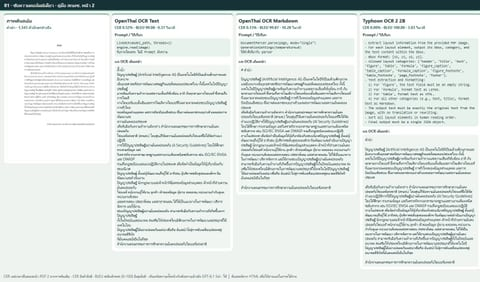
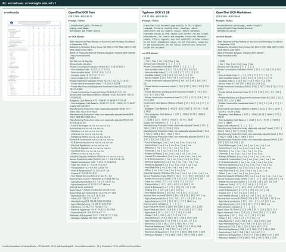
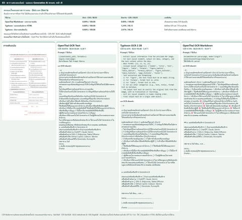
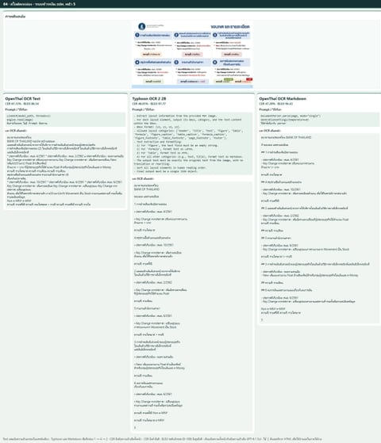
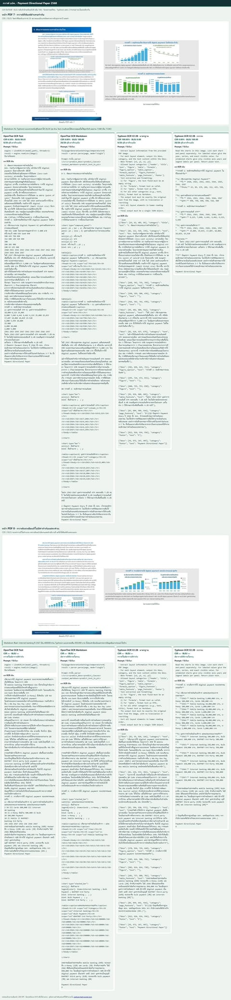
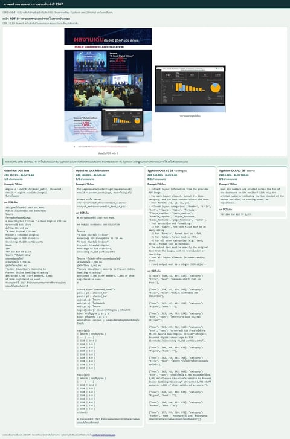
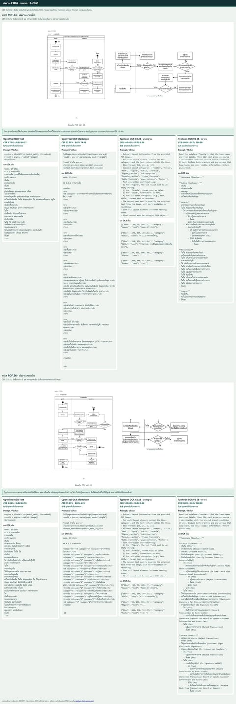
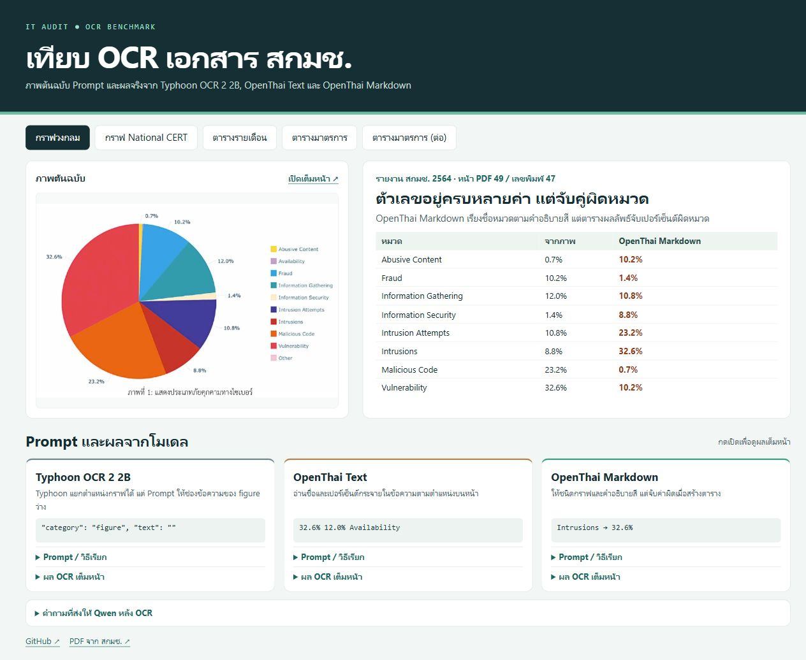
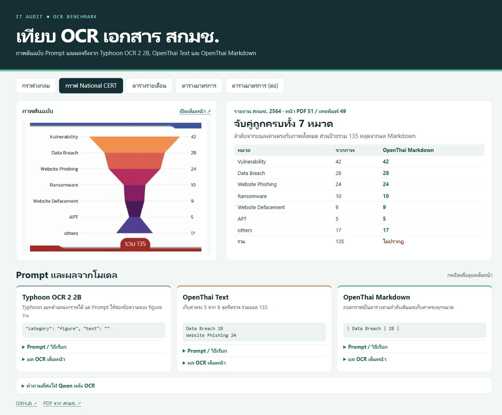

# รีวิว OCR ภาษาไทยสามรุ่นบน PDF จริง

[English](README.md)

ใน PDF เล่มเดียวกันอาจมีทั้งย่อหน้า ตาราง สไลด์ และผังงาน ผมลองให้ **OpenThai OCR Text**, **OpenThai OCR Markdown** และ **Typhoon OCR V2 2B** อ่านภาพหน้าเดียวกัน แล้วดูทั้งว่าถอดข้อความได้ตรงแค่ไหนและยังจับคู่ข้อมูลตามต้นฉบับได้หรือเปล่า

[เปิดเว็บเปรียบเทียบภาษาไทย](https://lengtsp.github.io/openthai2.0_ocr_markdown_and_text_test/th.html)

## 1. เริ่มจากข้อความอ่านต่อเนื่อง

ในชุดย่อย 10 หน้าที่เน้นข้อความคอลัมน์เดียว OpenThai Text อ่านผิด **0.39%** ใกล้กับ Typhoon ที่ **0.40%** และ OpenThai Markdown ที่ **0.70%** เวลาต่อหน้าค่ากลางอยู่ที่ **0.31**, **4.53** และ **11.58 วินาที** ตามลำดับบนเครื่องที่ทดสอบ ถ้าโจทย์คือดึงย่อหน้าจากคู่มือหรือนโยบายไปค้นต่อ ผมเริ่มที่ OpenThai Text [ผลชุดข้อความ 10 หน้า](data/prose-results.json)

## 2. ดูว่าตารางและสไลด์เก็บตำแหน่งได้แค่ไหน

OpenThai Markdown เหมาะกับการอ่านทีละคอลัมน์ เช่น รายการ Do’s และ Don’ts ของ สกมช. ที่เก็บได้ครบ **9 ข้อต่อฝั่ง** ส่วน Typhoon มีประโยชน์เมื่อโจทย์ต้องการให้เก็บคู่ซ้าย–ขวาของแต่ละแถวเป็น HTML พอเป็นสไลด์หลายกล่อง ต้องตรวจลำดับอ่านเพิ่ม เพราะคำอาจถูกแต่ไปอยู่กับอีกหัวข้อหนึ่ง

### คะแนนจากชุดทดสอบแยกตามรูปแบบหน้า

OpenThai OCR Text ทำได้ใกล้ Typhoon OCR 2 2B และ OpenThai OCR Markdown ที่สุดในหน้าเน้นข้อความอ่านต่อเนื่อง แต่ผลต่างกว้างขึ้นเมื่อข้อมูลอยู่ในตารางหรือกระจายหลายกล่องบนสไลด์

| ประเภทหน้า | จำนวนหน้า | OpenThai Text | Typhoon OCR 2 2B | OpenThai Markdown |
|---|---:|---:|---:|---:|
| ข้อความอ่านต่อเนื่อง | 30 | 2.35% | **1.69%** | 1.70% |
| ตารางไม่ซับซ้อน | 5 | 9.25% | **1.71%** | 2.50% |
| ตารางซับซ้อน | 13 | 23.28% | 20.25% | **10.66%** |
| สไลด์ ธปท. ที่ส่งออกเป็น PDF | 33 | 52.56% | **18.55%** | 21.88% |

แต่ละแถวเทียบทั้งสามโมเดลบนหน้าเดียวกันด้วยอัตราความผิดพลาดของตัวอักษร (CER) ยิ่งต่ำยิ่งดี แถวสไลด์มาจากเอกสาร ธปท. หนึ่งฉบับ และบางหน้าซ้ำกับกลุ่มข้อความหรือตาราง [ผลแยกตามรูปแบบหน้า](qwen-ocr-routing.md) · [คะแนนรายหน้า](data/per-page.csv)

- **ข้อความ** OpenThai Text ตามคะแนนที่ดีที่สุด 0.66 จุดเปอร์เซ็นต์ในกลุ่มข้อความอ่านต่อเนื่อง เหมาะกับการดึงย่อหน้าจากนโยบายหรือคู่มือไปค้นและทำดัชนี [ผลแยกตามรูปแบบหน้า](qwen-ocr-routing.md)
- **ตาราง** ตารางรายเดือน สกมช. ได้ตัวเลขถูกแถวและเดือน 75/130 ช่องสำหรับ Text และ 130/130 สำหรับ Typhoon กับ Markdown ส่วนแบบกระทบยอดธนาคารจำลองได้ 89/90, 90/90 และ 89/90 ตามลำดับ สำหรับ IT Audit ให้ตรวจความถูกต้องรายช่องก่อนใช้ยอดเงินหรือสถานะประกอบข้อค้นพบ [ตารางรายเดือน สกมช.](https://lengtsp.github.io/openthai2.0_ocr_markdown_and_text_test/th.html#monthly) · [ผลทดสอบ Internal Audit](internal-audit-ocr-review.md)
- **สไลด์** หน้า 23 ที่มี bullet กลุ่มเดียวได้ CER 10.94%, 7.29% และ 0.96% ตามลำดับ ส่วนหน้า 27 ที่ฝังภาพฟอร์มได้ 84.64%, 1.44% และ 8.00% ตามลำดับ [PDF สไลด์ ธปท. หน้า 27](https://www.bot.or.th/content/dam/bot/documents/th/our-roles/payment-systems/payment/payment-all-hearing/payment-supervisory-data.pdf#page=27) · [คะแนนรายหน้า](data/per-page.csv)

## 3. เพิ่มกราฟ ภาพหน้าจอ และผังงาน

| ตัวอย่าง | OpenThai Text | OpenThai Markdown | Typhoon มาตรฐาน | Typhoon แบบถามเจาะจง |
|---|---|---|---|---|
| กราฟ ธปท. หน้า 7 | อ่านได้หลายค่า แต่ยังไม่จับคู่ปี | **26/26** คู่ปีและค่า | 0/26 คู่ | **26/26** คู่ปีและค่า |
| ภาพหน้าจอ สกมช. หน้า 8 | **6/6** ค่า สลับสองตัวแรก | 0/6 ค่า | 0/6 ค่า | **6/6** ค่า เรียงถูก |
| ผังงาน ETDA หน้า 24 และ 26 | ชื่อกล่องเกือบครบ · 0/12 ลูกศร | แปลงเป็นตาราง · 0/12 ลูกศร | จัดเป็นภาพ · 0/12 ลูกศร | **6/12** ลูกศร |

- **กราฟ ธปท.** ถ้ากราฟพิมพ์ตัวเลขไว้ Markdown กับ Typhoon แบบถามเฉพาะกราฟทำได้พอกัน พอเป็นกราฟแท่งซ้อนหน้า 8 ที่ไม่มีเลขกำกับ ทั้งคู่คืนค่าต่างกัน เช่น Internet banking ปี 2567 ได้ 400,000 กับ 450,000 จึงต้องเปิดข้อมูลต้นทางก่อนอ้างตัวเลข [ภาพเปรียบเทียบกราฟ](docs/assets/regulator-chart.jpg) · [PDF ธปท.](https://www.bot.or.th/content/dam/bot/documents/th/our-roles/payment-systems/payment-systems-policy/payment-directional-paper-2568-th.pdf#page=7)
- **ภาพหน้าจอ สกมช.** Text พบเลขครบ แต่คืน `284` ก่อน `747` ส่วน Typhoon แบบถามเฉพาะเลขบนจอคืนครบและเรียงตรงภาพ คะแนนนี้วัดตัวเลขที่เลือกตรวจ ชื่อมาตรวัดต้องเช็กแยก [ภาพเปรียบเทียบหน้าจอ](docs/assets/regulator-dashboard.jpg) · [PDF สกมช.](https://www.ncsa.or.th/media/uploads/2025/03/14/ncsa-annual-2024_e-book_uid_67d3ad045e4fa.pdf#page=8)
- **ผังงาน ETDA** Text เหมาะกับการดึงชื่อขั้นตอนไปค้น ส่วน Typhoon แบบเจาะจงตามลูกศรได้ดีที่สุดในตัวอย่างนี้ แต่ยังอ่านทางแยกผิด เช่น เมื่อข้อมูลครบ ต้นฉบับให้ไปลงลายมือชื่ออิเล็กทรอนิกส์ แต่ผล OCR พาไปปฏิเสธรายการ [ภาพเปรียบเทียบผังงาน](docs/assets/regulator-flow.jpg) · [แหล่ง PDF และหน้าที่ทดสอบ](data/regulator-visual/sources.json)

ดู CER และ BLEU ของจุดที่เลือกตรวจ

| จุดที่วัด | OpenThai Text | OpenThai Markdown | Typhoon มาตรฐาน | Typhoon แบบถามเจาะจง |
|---|---:|---:|---:|---:|
| กราฟ ธปท. หน้า 7 · ค่าที่พิมพ์ 26 จุด | 6.38% / 86.81 | 0.00% / 100.00 | 100.00% / 0.00 | 0.00% / 100.00 |
| หน้าจอ สกมช. หน้า 8 · เลข 6 ค่าตามลำดับ | 33.33% / 76.68 | 100.00% / 0.00 | 100.00% / 0.00 | 0.00% / 100.00 |
| ผังฝากเช็ค ETDA หน้า 24 · ชื่อกล่อง 8 จุด | 0.70% / 99.23 | 22.38% / 74.95 | 100.00% / 0.00 | 0.00% / 100.00 |
| ผังถอนเงิน ETDA หน้า 26 · ชื่อกล่อง 8 จุด | 0.63% / 98.78 | 75.95% / 4.25 | 100.00% / 0.00 | 0.00% / 100.00 |

แต่ละช่องแสดง **CER / BLEU ระดับตัวอักษร** เฉพาะจุดที่ระบุ CER ยิ่งต่ำยิ่งดี ส่วน BLEU ยิ่งใกล้ 100 ยิ่งดี ค่าที่ไม่คืนถูกนับเป็นข้อความว่าง คะแนนลูกศรและการจับคู่ปี–ค่าอยู่ในตารางด้านบน กราฟแท่งซ้อนหน้า 8 เว้นคะแนนค่ารายปีเพราะภาพไม่มีตัวเลขกำกับแต่ละส่วน [รายการตรวจลูกศร](data/regulator-visual/flow-review.json)

## ภาพและผลทดสอบตามลำดับ 1–7

### 1. คำนำคู่มือ สกมช. · ข้อความคอลัมน์เดียว

Typhoon อ่านตรงกับข้อความอ้างอิง (CER 0.00%, BLEU 100.00) ส่วน OpenThai Markdown สะกด “Artificial” เป็น “Artifificial” (CER 0.13%, BLEU 99.87) และ OpenThai Text อ่าน “AI” เป็น “Al” พร้อมอ่านคำว่า “คำนำ” ผิด (CER 0.52%, BLEU 99.08) แต่ใช้เวลาเพียง 0.37 วินาที เทียบกับ Typhoon 3.03 วินาที และ Markdown 10.28 วินาที Text เหมาะกับหน้าลักษณะนี้เมื่อต้องการทำคู่มือหรือนโยบายให้ค้นได้

ดูภาพเปรียบเทียบและเปิดภาพเต็ม

### 2. ตารางเศรษฐกิจ ธปท. · ตัวเลขกับแถว

OpenThai Markdown ได้คะแนนข้อความทั้งหน้าดีที่สุดและวางตัวเลขถูกตำแหน่งในสองแถวที่ตรวจ OpenThai Text อ่านตามลำดับแถว แต่ทำจุดทศนิยมบางตำแหน่งหายหรืออ่านผิด ส่วน Typhoon ใช้ Prompt ที่กำหนดเองแล้วได้ตาราง HTML แต่เลื่อนค่าทั้งชุดไปอยู่ผิดรายการ

ดูภาพเปรียบเทียบและเปิดภาพเต็ม

### 3. Do’s และ Don’ts ของ สกมช. · สองรายการแยกฝั่ง

OpenThai Markdown เก็บครบ 9 ข้อต่อฝั่งตามลำดับ Typhoon เก็บแต่ละข้อไว้ถูกฝั่งในรูปแบบ HTML ที่จับคู่รายแถว หากต้องการอ่านทีละฝั่ง ให้ดึงคอลัมน์ซ้ายทั้งหมดก่อนแล้วค่อยดึงคอลัมน์ขวา ส่วน OpenThai Text ดึงคำว่า “ความถูกต้อง” จากฝั่ง Don’ts ไปต่อท้ายบรรทัดของฝั่ง Do’s ผลที่ได้โดยตรงจาก Markdown แยกสองรายการได้ชัดที่สุด

ดูภาพเปรียบเทียบและเปิดภาพเต็ม

### 4. สไลด์ ธปท. · ลำดับกล่องทั้งหก

ต้นฉบับเรียง 1 → 2 → 3 → 4 → 5 → 6 แต่ Typhoon และ OpenThai Markdown อ่านลงคอลัมน์เป็น 1 → 4 → 2 → 5 → 3 → 6 Typhoon เก็บถ้อยคำได้ใกล้ต้นฉบับหลายช่วง (CER 48.01%, BLEU 97.77) ส่วน Markdown อ่าน “ความถี่: รายเดือน” ซ้ำ (CER 47.28%, BLEU 94.43) และ Text รวมข้อความข้ามกล่องพร้อมอ่านผิดเพิ่ม (CER 67.13%, BLEU 86.54) BLEU ยังสูงได้เมื่อข้อความแต่ละช่วงตรงกันแม้ลำดับทั้งหน้าจะเปลี่ยน

ดูภาพเปรียบเทียบและเปิดภาพเต็ม

### 5. กราฟ ธปท. · จับคู่ปีกับค่าที่พิมพ์ไว้

OpenThai Markdown และ Typhoon แบบถามเฉพาะกราฟจับคู่ปีและค่าได้ครบ 26/26 จุด OpenThai Text อ่านได้หลายค่าแต่จับคู่กับปีได้ยาก ส่วน Typhoon มาตรฐานเจอกราฟแต่เว้นข้อความในกราฟไว้ สำหรับกราฟแท่งซ้อนที่ไม่พิมพ์ค่าไว้ Markdown กับ Typhoon แบบเจาะจงคืนตัวเลขต่างกัน จึงควรอ้างจากข้อมูลต้นทาง

ดูภาพเปรียบเทียบและเปิดภาพเต็ม

### 6. ภาพหน้าจอ สกมช. · Typhoon แบบเจาะจงเรียงตัวเลขได้ดีที่สุด

Typhoon แบบถามเฉพาะเลขบนจอคืนครบทั้ง 6 ค่าและเรียงตรงภาพ OpenThai Text อ่านครบเช่นกันแต่สลับสองตัวแรก ส่วน OpenThai Markdown และ Typhoon มาตรฐานอ่านคำบรรยายรอบภาพได้แต่พลาดตัวเลขทั้งหกค่าบนจอ

ดูภาพเปรียบเทียบและเปิดภาพเต็ม

### 7. ผังงาน ETDA · อ่านชื่อขั้นตอนและตรวจลูกศร

OpenThai Text อ่านชื่อกล่องที่ตรวจได้เกือบครบ OpenThai Markdown แปลงผังเป็นตารางและตกหล่นหลายกล่องในหน้าถอนเงิน ส่วน Typhoon มาตรฐานจัดผังเป็นภาพและเว้นข้อความในผังไว้ Typhoon แบบเจาะจงอ่านชื่อกล่องที่ตรวจครบและตามลูกศรถูก 6/12 เส้น แต่พาเงื่อนไขข้อมูลครบไปปฏิเสธรายการ ทั้งที่ต้นฉบับให้ลงลายมือชื่อ ก่อนใช้เป็นหลักฐาน Audit ควรตรวจลูกศรและเงื่อนไขกับต้นฉบับทุกจุด

ดูภาพเปรียบเทียบและเปิดภาพเต็ม

## 4. เลือกใช้ในงาน IT Audit

ผมจะใช้ **OpenThai Text** กับหน้าเนื้อหาที่ต้องค้น ใช้ **OpenThai Markdown** กับรายการหลายคอลัมน์หรือกราฟที่มีค่ากำกับ และใช้ **Typhoon แบบเจาะจง** เมื่ออยากได้ตัวเลขบนภาพ คู่ข้อมูลในแต่ละแถว หรือเส้นทางในผังงาน ก่อนนำไปอ้างในรายงาน ผมจะย้อนดูว่าตัวเลขอยู่กับหัวข้อ ปี และหน่วยที่ถูกต้อง รวมถึงตรวจว่าลูกศรพาไปยังขั้นตอนที่ตรงกับเงื่อนไข [ผลทดสอบ Internal Audit](internal-audit-ocr-review.md)

## ตัวอย่างโต้ตอบจากเอกสาร สกมช.

[เปิดเว็บเปรียบเทียบ](https://lengtsp.github.io/openthai2.0_ocr_markdown_and_text_test/th.html) · [ซอร์สเว็บและข้อมูลผล OCR](docs/)

สลับดูกราฟวงกลม กราฟ National CERT ตารางรายเดือน และตารางมาตรการสองหน้า เทียบภาพต้นฉบับกับผลจริงจาก Typhoon OCR 2 2B, OpenThai Text และ OpenThai Markdown พร้อมเปิดดู Prompt หรือวิธีเรียกของแต่ละรุ่นได้

**กราฟวงกลม ThaiCERT** · OpenThai Markdown อ่านชื่อหมวดได้ แต่จับคู่เปอร์เซ็นต์ผิด เช่น 32.6% เป็นของ Vulnerability ในภาพ ส่วนผล OCR ผูกกับ Intrusions

**กราฟ National CERT** · Markdown เก็บชื่อและค่าครบทั้ง 7 หมวดตามลำดับภาพ ป้ายยอดรวม 135 หลุดจากผล OCR ส่วน Typhoon ใช้ Prompt ที่กำหนดให้ข้อความของบล็อกภาพว่าง

จาก PDF สาธารณะ 6 ฉบับ 293 หน้า **Typhoon OCR V2 2B มี CER รวมต่ำที่สุด (5.07%)** ส่วน OpenThai Text ใช้เวลาต่อหน้าต่ำที่สุดในชุดทดสอบนี้ ผลต่างกันตามเอกสาร จึงควรดูคะแนนรายฉบับและรูปแบบผลลัพธ์ประกอบ

| ตัวชี้วัด | Typhoon OCR V2 2B | OpenThai Text | OpenThai Markdown |
|---|---:|---:|---:|
| CER รวม ↓ | 5.07% | 7.98% | 5.96% |
| F1 ของโทเคนตัวเลข ↑ | 98.02% | 96.35% | 96.55% |
| หน้าที่มีตาราง HTML ในผลลัพธ์ | 139 | 0 | 142 |
| หน้าที่ผลลัพธ์ไม่สมบูรณ์ | 1 | 0 | 0 |
| หน้าว่างที่มีข้อความเกิน | 0 | 0 | 7 |
| เวลามัธยฐานต่อคำขอ (วินาที) | 4.55 | 0.27 | 8.74 |

CER วัดการแทนที่ ลบ และเพิ่มอักขระตามลำดับการอ่านหลังปรับ Unicode และตัดช่องว่าง คะแนนต่ำกว่าหมายถึงผลใกล้ข้อความอ้างอิงกว่า ส่วน F1 ตัวเลขวัดความตรงของโทเคนตัวเลขภายในหน้า จึงอาจได้คะแนนสูงแม้ยอดอยู่ผิดช่อง จำนวนหน้าที่ได้ตาราง HTML บอกความครอบคลุมของผลลัพธ์ประเภทนี้เท่านั้น

## ผลตามเอกสาร

| เอกสาร | หน้าที่คิด CER | Typhoon OCR V2 2B | OpenThai Text | OpenThai Markdown |
|---|---:|---:|---:|---:|
| งบการเงิน ธปท. 2568 | 82 | 0.72% | 2.20% | 1.36% |
| สไลด์ระบบชำระเงิน ธปท. | 33 | 18.55% | 52.56% | 21.88% |
| งบประมาณโดยสังเขป 2569 | 137 | 5.00% | 2.76% | 5.39% |
| ราชกิจจานุเบกษา ประกาศ ธปท. | 15 | 1.30% | 1.42% | 2.51% |
| ราชกิจจานุเบกษาฉบับสแกน พ.ศ. 2475 | 14 | 1.34% | 3.14% | 1.50% |
| แบบ ภ.ง.ด. 90/91 และใบแนบ | 5 | 25.54% | 47.53% | 29.58% |

## ตารางและลำดับการอ่าน

ตัวอย่างที่ตรวจจากต้นฉบับคือ **งบการเงิน ธปท. 2568 หน้า PDF 7** ตรวจยอดของ 3 รายการในคอลัมน์ปี 2568 และ 2567 รวม 6 ช่อง โดยคงวงเล็บของยอดติดลบไว้

| รุ่น | ผลตรวจโครงสร้างและยอดเงิน |
|---|---|
| Typhoon OCR V2 2B | 6/6 ตามตำแหน่ง และ 6/6 เมื่อเช็กหัวปีด้วย |
| OpenThai Text | ข้อความพร้อมพิกัดบรรทัด |
| OpenThai Markdown | 6/6 ตามตำแหน่ง และ 3/6 เมื่อเช็กหัวปีด้วย |

OpenThai Markdown วางยอดเงินในคอลัมน์ตัวเลขตามภาพได้ครบ แต่แทนหัวปี **2567** ด้วยข้อความ **หน่วย : บาท** การอ่านตัวเลขถูกจึงยังต้องตรวจชื่อคอลัมน์ก่อนนำไปใช้

ใน **งบประมาณ หน้า PDF 113** ทั้ง Typhoon และ OpenThai Markdown อ่านยอดที่ตรวจ 6 ช่องได้ตรงตามตำแหน่งในแถว แต่แยกช่องหัวตารางแนวทแยงของต้นฉบับเป็นสองคอลัมน์ ทำให้หัวตารางเลื่อนและจับคู่ยอดกับหัวคอลัมน์ผิดทั้ง 6 ช่องที่ตรวจ

ชุดสไลด์มีข้อความในหลายคอลัมน์และตารางซ้อนหัวคอลัมน์ CER จึงสะท้อนทั้งความตรงของข้อความและการจัดลำดับ ส่วนผลตรวจ 6 ช่องเป็นตัวอย่างที่ตรวจด้วยสายตาและไม่ใช่คะแนนความถูกต้องรายช่องของทั้งชุด

## หน้าว่างและความเสถียร

PDF งบประมาณหน้า 6 เป็นหน้าว่างจริง แต่ OpenThai Markdown คืนรายการปีตั้งแต่ 2014 เป็นต้นไป การตรวจภาพที่พิกเซลสว่างทั้งหมดก่อนส่งเข้า OCR ตรวจพบหน้าว่าง 7 หน้าและตัดหน้าที่มีข้อความผิด 0 หน้าในชุดนี้ ผล CER หลักใช้ผลที่รันโดยยังไม่เปิดตัวกรองดังกล่าว

## การใช้งานและเวลา

- **OpenThai Text** ส่งคืนข้อความ พิกัด และความมั่นใจรายบรรทัด รันบน CPU ได้ เหมาะกับการอ่านข้อความหรือทำดัชนีในงานที่ไม่ต้องการโครงสร้างตาราง
- **OpenThai Markdown** ส่งคืน Markdown พร้อม HTML สำหรับตารางและพิกัดระดับบล็อก ใช้น้ำหนัก 2.52 GB จาก revision `7a153712e5b50fac7e4a9d42ccf9ec41fb4202f0` ทดสอบแบบ single pass ที่ temperature 0 บน GPU ด้วย vLLM 0.27.1 แบบ eager พร้อมปิด MTP และใช้ตัวแปลงผลของผู้พัฒนา
- **Typhoon OCR V2 2B** ส่งคืนบล็อก JSON พร้อมประเภท พิกัด และ HTML ของตาราง ใช้ prompt มาตรฐานของผู้พัฒนาบน vLLM 0.33.0

เวลาที่รายงานเป็นเวลามัธยฐานต่อคำขอ ไม่รวมแปลง PDF และโหลดโมเดล OpenThai Text ใช้ OpenVINO บน CPU หนึ่งเธรด ส่วนทั้งสองรุ่นที่สร้างโครงสร้างใช้ vLLM บน RTX PRO 6000 Blackwell โดยมีคำขอพร้อมกันได้ถึงสี่คำขอ วัดคนละรอบและเวลา OpenThai Markdown รวมคำขอชุดแรกที่มีการอุ่นระบบ จึงใช้เป็นข้อมูลการใช้งานบนเครื่องนี้

## วิธีทดสอบ

- ใช้ PDF สาธารณะ 6 ฉบับ เรนเดอร์ 200 DPI และตรวจ SHA-256 ว่าทั้งสามรุ่นอ่านภาพเดียวกัน โดยไม่ได้ตรวจว่าเอกสารทับซ้อนกับข้อมูลฝึกของแต่ละรุ่นหรือไม่
- ใช้ GPT‑6.1 Sol ถอดข้อความจากภาพต้นฉบับโดยไม่ป้อนผล OCR ให้ดู มี 286 หน้าที่คำนวณ CER และ 7 หน้าว่าง ช่วงที่อ่านไม่ได้ใน 13 หน้าถูกข้ามในการคำนวณ
- แปลง Markdown และ HTML เป็นข้อความก่อนคิด CER โดยคงลำดับข้อความและเครื่องหมายที่เป็นเนื้อหา
- คะแนนหลักนับผลที่ถูกตัดหรือแปลงไม่ได้เป็นหน้าล้มเหลว สำหรับ Typhoon พบกรณีนี้ในแบบ ภ.ง.ด. 90 หน้า PDF 1
- ผลอ้างอิงถอดด้วยโมเดลภาษาและตรวจด้วยสายตาบางตัวอย่าง คะแนนครอบคลุมชุดเอกสารนี้

[แหล่งเอกสารและ SHA-256](data/sources.json) · [ผลรายหน้า](data/per-page.csv) · [ผลรวม](data/results.json) · [ตรวจยอดเงินรายช่อง](data/table-spotcheck.json) · [ตรวจตารางงบประมาณ](data/budget-table-spotcheck.json) · [การตรวจหน้าว่าง](data/blank-gate.json)

[ผลทดสอบ สกมช. 27 หน้า](ncsa-ocr-review.md) · [รายงานประจำปี สกมช. ครบ 152 หน้า](ncsa-annual-full-review.md) · [Qwen จัดประเภทหน้า](qwen-ocr-routing.md) · [Qwen ถอดข้อความอ้างอิง](qwen-ground-truth-review.md) · [แนวทางตรวจไฟล์ก่อนเผยแพร่](PUBLISHING.md)

[iApp OpenThai OCR Text](https://huggingface.co/iapp/OpenThai2.0-OCR-Text) · [iApp OpenThai OCR Markdown](https://huggingface.co/iapp/OpenThai2.0-OCR-Markdown) · [Typhoon OCR V2 2B](https://huggingface.co/typhoon-ai/typhoon-ocr2-2b)
